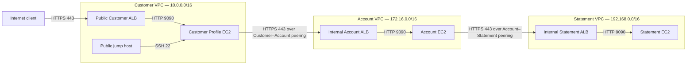
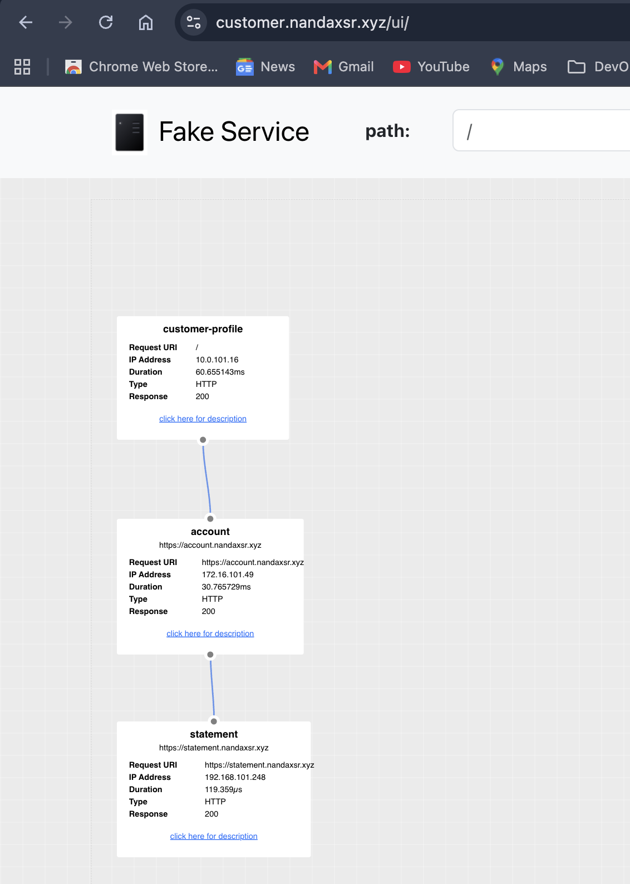
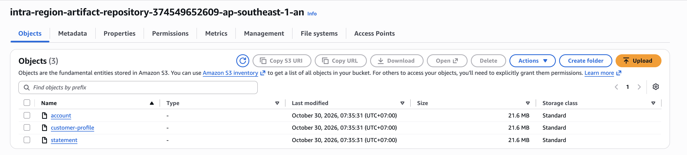
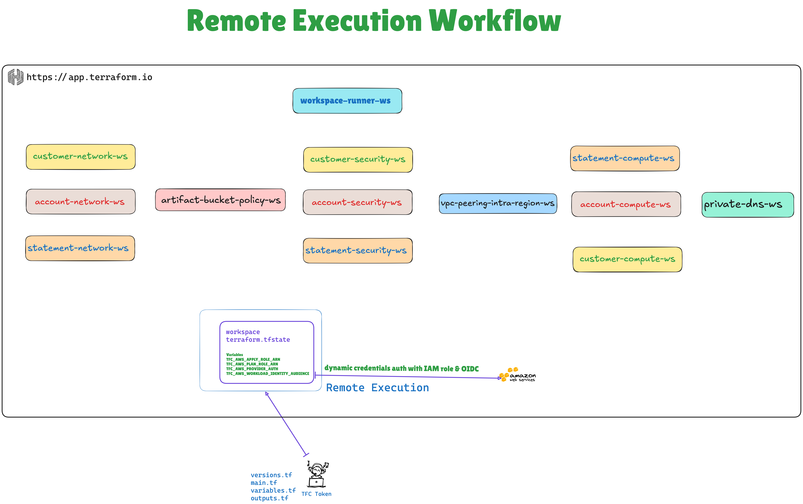
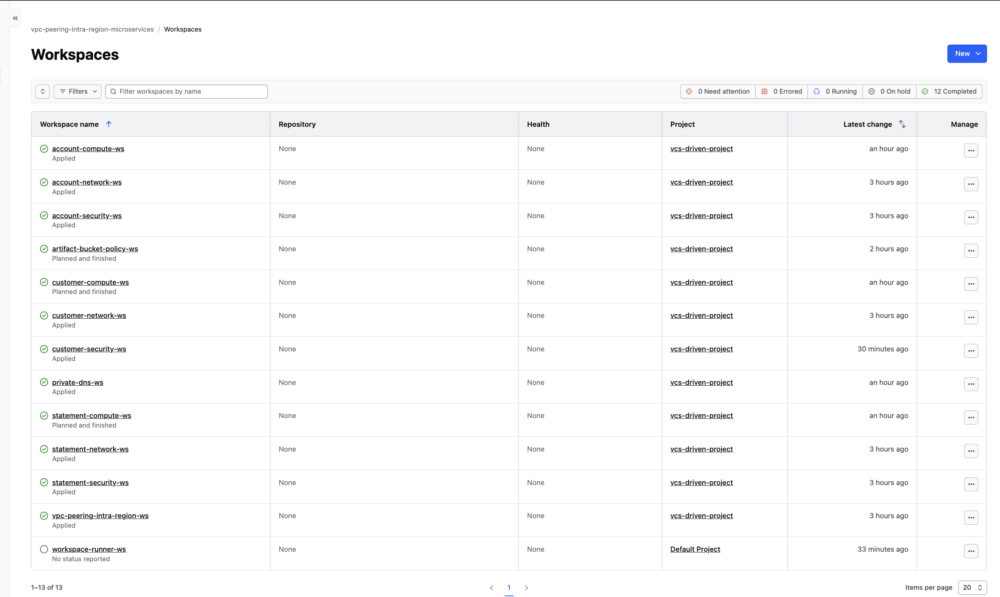
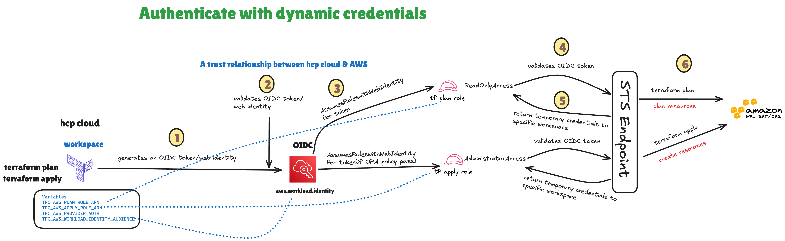
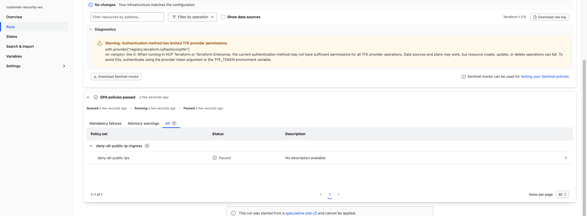
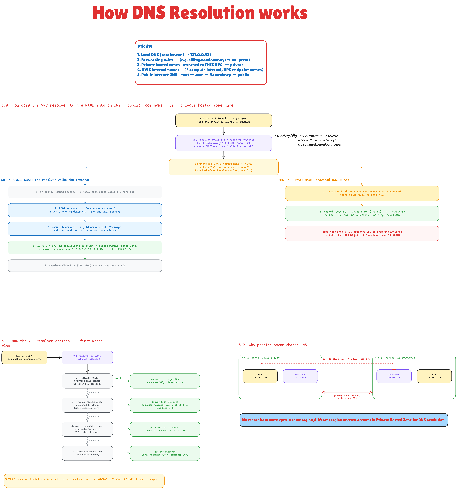
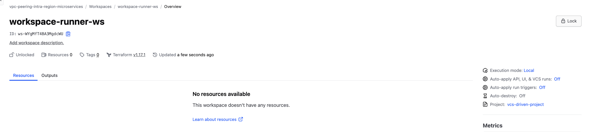

# Inter-Region VPC Peering for Microservices on AWS

Three microservices communicate across separate VPCs in **Singapore (`ap-southeast-1`)**, **Malaysia (`ap-southeast-5`)**, and **Tokyo (`ap-northeast-1`)** respectively. Customer Profile provides the public entry point, while Account and Statement remain private behind internal Application Load Balancers (ALBs).

The architecture combines explicit subnet routing, controlled inbound and outbound traffic, private service discovery, and HTTPS communication between services. Terraform manages each infrastructure layer through a separate HCP Terraform workspace, with OIDC-based AWS authentication and OPA policy checks before deployment.

**Original intra-region reference repository:** [cloudhein/aws-vpc-peering-intra-region-microservices](https://github.com/cloudhein/aws-vpc-peering-intra-region-microservices)  
**HCP Terraform organization:** `vpc-peering-intra-region-microservices`

## Inter-Region Configuration

| Service | Region | Existing artifact bucket | Object key |
|---|---|---|---|
| Customer Profile | Singapore (`ap-southeast-1`) | `customer-374549652609-ap-southeast-1-an` | `customer-profile` |
| Account | Malaysia (`ap-southeast-5`) | `account-374549652609-ap-southeast-5-an` | `account` |
| Statement | Tokyo (`ap-northeast-1`) | `statement-374549652609-ap-northeast-1-an` | `statement` |

The network, security, and compute workspace defaults match this table. Update any existing HCP `region` variables or variable sets that override these defaults. Enable Malaysia in the AWS account before deployment. The peering and artifact-policy workspaces use their default AWS provider for Singapore and aliased providers for Malaysia and Tokyo, reading those Regions from the network outputs. Their AWS roles must have permission to manage the resources in all three Regions.

The HCP organization name and existing project tags remain `vpc-peering-intra-region-microservices`. Only the peering folder and HCP workspace name change to `vpc-peering-inter-region-ws`; update that workspace's working directory and any existing runner variable override. This configuration does not create or rename HCP workspaces. Use separate workspace states for this inter-region deployment; changing Region defaults does not move resources already managed in Singapore.

Keep `certificate_arn` in each compute workspace's HCP Terraform variables. Each certificate must exist in its service's Region and cover that service's DNS name. Set Customer and Account `upstream_url` to their HTTPS URLs in HCP when HTTPS is required; the existing HTTP defaults are unchanged. Any pinned `ami_id` must also belong to that workspace's Region.

Create or replicate the existing `microservices/ssh-public-key` Secrets Manager secret in all three Regions, containing the same public SSH key. Each compute workspace creates its own regional `microservices-ssh-key` key pair. Import any existing key pair into that workspace before applying if it already exists.

The artifact-policy workspace manages the complete policy on each of the three existing buckets. Review any existing policies before applying, and import policies already managed outside this configuration as needed. Downloads and bucket listing outside the matching VPC endpoint are denied, including console downloads; uploads and bucket-policy management are not denied by these rules. The existing unsigned HTTPS `curl` downloads remain supported by the endpoint-conditioned bucket policies and endpoint policies.

The screenshots below are retained from the original intra-region deployment; they are reference images, not validation of this inter-region deployment.

## Contents

- [Architecture](#architecture)
- [Application Traffic and TLS](#application-traffic-and-tls)
- [Infrastructure Overview](#infrastructure-overview)
- [Routing and VPC Isolation](#routing-and-vpc-isolation)
- [Security Group Controls](#security-group-controls)
- [Private Application Delivery from S3](#private-application-delivery-from-s3)
- [Remote Execution Workflow](#remote-execution-workflow)
- [Dynamic AWS Credentials with OIDC](#dynamic-aws-credentials-with-oidc)
- [OPA Policy Checks](#opa-policy-checks)
- [DNS Resolution](#dns-resolution)
- [Workspace Dependencies and Cleanup](#workspace-dependencies-and-cleanup)
- [References](#references)

## Architecture


[View the full-resolution architecture diagram](assets/architecture.png).



Only **Customer ↔ Account** and **Account ↔ Statement** are peered. Customer has no direct connection to Statement. Account makes a new application request to Statement and returns the result to Customer; it does not act as a transit router.

## Application Traffic and TLS

### Request Flow

1. A client resolves `customer.nandaxsr.xyz` through public DNS and connects to the internet-facing Customer ALB. Requests on HTTP port 80 are redirected to **HTTPS port 443**, so public application requests are served through HTTPS.
2. The Customer ALB forwards the request to Customer Profile in its private subnet.
3. Customer Profile resolves `account.nandaxsr.xyz` through Route 53 Resolver and calls the Account internal ALB over HTTPS across Customer–Account VPC peering.
4. Account resolves `statement.nandaxsr.xyz` and calls the Statement internal ALB over HTTPS across Account–Statement VPC peering.
5. The response returns through **Statement → Account → Customer Profile → client**.

Each ALB has an HTTPS listener with a certificate in ACM. HTTPS encrypts the upstream connections from Customer Profile to Account and from Account to Statement as they cross VPC boundaries.

### Successful Application Result



Customer Profile successfully accesses both upstream services through HTTPS, with all three services returning **HTTP 200**.

| Service | Request | Application IP | Response |
|---|---|---|---|
| Customer Profile | `/` | `10.0.101.16` | 200 |
| Account | `https://account.nandaxsr.xyz` | `172.16.101.49` | 200 |
| Statement | `https://statement.nandaxsr.xyz` | `192.168.101.248` | 200 |

## Infrastructure Overview

### Network Layout

| Component | Customer | Account | Statement |
|---|---|---|---|
| Region | Singapore (`ap-southeast-1`) | Malaysia (`ap-southeast-5`) | Tokyo (`ap-northeast-1`) |
| VPC CIDR | `10.0.0.0/16` | `172.16.0.0/16` | `192.168.0.0/16` |
| Public subnets | `10.0.1.0/24`, `10.0.2.0/24` | None | None |
| Private subnets | `10.0.101.0/24`, `10.0.102.0/24` | `172.16.101.0/24`, `172.16.102.0/24` | `192.168.101.0/24`, `192.168.102.0/24` |
| ALB placement | Public subnets, internet-facing | Private subnets, internal | Private subnets, internal |
| Application instance | First private subnet | First private subnet | First private subnet |
| Internet gateway | Yes, public route table only | None | None |
| NAT gateway | None | None | None |
| Private route table | One shared by both private subnets | One shared by both private subnets | One shared by both private subnets |
| S3 gateway endpoint | One | One | One |
| Additional instance | Jump host in first public subnet | None | None |

Subnets span two Availability Zones. All VPCs enable DNS support and DNS hostnames.

## Routing and VPC Isolation

Private route tables contain explicit routes to the required remote **`/24` subnets**. Peering access is limited to those subnet ranges, and the private tables have no internet default route.

| Route table | Explicit destination | Target |
|---|---|---|
| Customer public | `0.0.0.0/0` | Customer internet gateway |
| Customer private | `172.16.101.0/24` | Customer–Account peering |
| Customer private | `172.16.102.0/24` | Customer–Account peering |
| Account private | `10.0.101.0/24` | Customer–Account peering |
| Account private | `10.0.102.0/24` | Customer–Account peering |
| Account private | `192.168.101.0/24` | Account–Statement peering |
| Account private | `192.168.102.0/24` | Account–Statement peering |
| Statement private | `172.16.101.0/24` | Account–Statement peering |
| Statement private | `172.16.102.0/24` | Account–Statement peering |
| Each private table | Regional S3 managed prefix list | Its own S3 gateway endpoint |

AWS also creates each VPC's local route. The eight peering routes are defined in [routes.tf](vpc-peering-inter-region-ws/routes.tf).

Both destination ALB subnets must be reachable: DNS can return nodes from either AZ. Return routes are required as well. Adding only one remote subnet can leave some connections without a valid path.

There is no Customer–Statement peering or route. **VPC peering is non-transitive**: the Customer–Account and Account–Statement links do not create Customer–Statement network connectivity. [AWS peering limitations](https://docs.aws.amazon.com/vpc/latest/peering/invalid-peering-configurations.html) describe this restriction.

Routing establishes the possible path. Security groups separately determine which sources, destinations, and ports can use it.

## Security Group Controls

Security groups control traffic at the ALBs and application instances. **Inbound rules define which sources may connect; outbound rules define which destinations may be reached.** Local rules reference security groups. Cross-region rules use private subnet CIDRs because [AWS does not support security group references across inter-region peering](https://docs.aws.amazon.com/vpc/latest/peering/vpc-peering-security-groups.html). Application rules use the first private subnet, where the instance runs; ALB egress rules cover both destination private subnets.

### Inbound and Outbound Rules

In the table below, **SSH** means TCP 22, **HTTP/HTTPS** means TCP 80/443, and **ping** means ICMP echo request, type 8/code 0.

| Security group | Permitted inbound sources | Permitted outbound destinations |
|---|---|---|
| Customer ALB | Internet IPv4: HTTP/HTTPS | Customer app SG: TCP 9090 |
| Customer app | Customer ALB SG: TCP 9090; Jump SG: SSH and ping; Account app subnet: ping | Account ALB subnets: HTTP/HTTPS; Account app subnet: SSH and ping; Regional S3 prefix list: HTTPS |
| Jump host | Administrator's public IPv4 `/32`: SSH | Customer app SG: SSH and ping |
| Account ALB | Customer app subnet: HTTP/HTTPS | Account app SG: TCP 9090 |
| Account app | Account ALB SG: TCP 9090; Customer app subnet: SSH and ping; Statement app subnet: ping | Statement ALB subnets: HTTP/HTTPS; Statement app subnet: SSH and ping; Customer app subnet: ping; Regional S3 prefix list: HTTPS |
| Statement ALB | Account app subnet: HTTP/HTTPS | Statement app SG: TCP 9090 |
| Statement app | Statement ALB SG: TCP 9090; Account app subnet: SSH and ping | Account app subnet: ping; Regional S3 prefix list: HTTPS |

The Customer ALB is the public application entry point. The Account ALB accepts connections from the Customer app subnet CIDR, and the Statement ALB accepts connections from the Account app subnet CIDR. Application port 9090 is reachable only from each service's own ALB SG. Outbound access is limited to the listed destinations; there is no allow-all egress rule.

### Controlled Administration Path

```text
Administrator's allowed public IP (/32)
                  │ SSH
                  ▼
              Jump host
                  │ SSH
                  ▼
         Customer Profile instance
                  │ SSH over Customer–Account peering
                  ▼
            Account instance
                  │ SSH over Account–Statement peering
                  ▼
           Statement instance
```

The jump host accepts SSH only from `admin_ipv4_cidr`. Its outbound rules allow access to the Customer instance, which provides the next permitted hop to Account. Account can then access Statement. This keeps management access on an explicit path through the environment.

### Cross-VPC Traffic Controls

A connection between services requires all four controls to agree:

1. The source subnet's route table must include the destination private subnet through the correct peering connection.
2. The destination subnet must have a return route.
3. The source security group must allow outbound traffic to the destination subnet CIDR and port.
4. The destination security group must allow inbound traffic from the source subnet CIDR and port.

For example, Customer Profile reaches the Account ALB on port 443 because the Customer private route table points to both Account ALB subnets, the Customer app SG permits HTTPS to both Account ALB subnet CIDRs, and the Account ALB SG accepts HTTPS from the Customer app subnet CIDR.

Security groups are stateful: responses to an allowed connection can return automatically. A reverse initiation, such as a new SSH connection in the other direction, requires its own rules. See [AWS security group behavior](https://docs.aws.amazon.com/vpc/latest/userguide/vpc-security-groups.html#vpc-security-groups-basics).

Local rules are defined in the [Customer](customer-security-ws/security.tf), [Account](account-security-ws/security.tf), and [Statement](statement-security-ws/security.tf) security workspaces. [Cross-VPC rules](vpc-peering-inter-region-ws/security.tf) are managed with the peering connections.

## Private Application Delivery from S3

The application binaries are stored in the three regional S3 artifact buckets listed above, under the object keys `customer-profile`, `account`, and `statement` respectively. Each application retrieves its binary privately through an **S3 gateway VPC endpoint** in its own VPC.



```text
Private application instance
          │ HTTPS
          ▼
Private route table → Regional S3 gateway endpoint → Regional S3 artifact bucket
```

Each bucket policy authorizes `s3:GetObject` and `s3:ListBucket` through its own service endpoint over HTTPS and explicitly denies reads outside that endpoint or without TLS. Each endpoint policy limits artifact downloads to the binary required by its service. Together, these controls provide private access to the application artifacts without exposing the bucket for public downloads.

The [artifact bucket policy workspace](artifact-bucket-policy-ws/policy.tf) reads the endpoint IDs from the three network workspaces and maintains a separate policy on each regional bucket. Each VPC has its own gateway endpoint because S3 gateway endpoints cannot be accessed through VPC peering. See [AWS S3 gateway endpoints](https://docs.aws.amazon.com/vpc/latest/privatelink/vpc-endpoints-s3.html).

## Remote Execution Workflow

Terraform plans and applies run in **HCP Terraform**. Commands submitted from the local CLI upload the configuration to HCP-managed workers, where each workspace uses its variables and AWS IAM role to manage the relevant resources. HCP Terraform stores and versions each workspace's state.



The infrastructure is organized into twelve remote workspaces and one local controller. Separate states let network, security, compute, DNS, and shared policy resources follow their own lifecycles while exchanging the outputs required by downstream workspaces.

### Workspace Responsibilities

| Workspace | Resources managed |
|---|---|
| `customer-network-ws` | Customer VPC, public/private subnets, route tables, IGW, and S3 endpoint |
| `account-network-ws` | Account VPC, private subnets, route table, and S3 endpoint |
| `statement-network-ws` | Statement VPC, private subnets, route table, and S3 endpoint |
| `artifact-bucket-policy-ws` | Three regional S3 artifact bucket policies |
| `customer-security-ws` | Customer ALB, application, and jump host security groups |
| `account-security-ws` | Account ALB and application security groups |
| `statement-security-ws` | Statement ALB and application security groups |
| `vpc-peering-inter-region-ws` | Peering connections, private subnet routes, and cross-VPC security group rules |
| `statement-compute-ws` | Statement instance, internal ALB, and regional EC2 key pair |
| `account-compute-ws` | Account instance, internal ALB, and regional EC2 key pair |
| `customer-compute-ws` | Customer instance, internet-facing ALB, jump host, and regional EC2 key pair |
| `private-dns-ws` | Private hosted zone, VPC associations, and service aliases |
| `workspace-runner-ws` | Dependency-ordered creation and destruction of the infrastructure workspaces |

Downstream workspaces retrieve required values through `data "tfe_outputs"`, including subnet IDs, security group IDs, endpoint IDs, and ALB attributes. Output access is granted to the workspaces that consume those values. The runner coordinates their execution order.



See [HCP Terraform's CLI-driven remote workflow](https://developer.hashicorp.com/terraform/cloud-docs/workspaces/run/cli).

## Dynamic AWS Credentials with OIDC

HCP Terraform authenticates to AWS through **OpenID Connect (OIDC) federation and IAM roles**. Each run receives temporary credentials for its workspace and execution phase, removing the need to store long-lived AWS access keys in HCP Terraform.



### Authentication Flow

1. HCP Terraform generates a signed workload identity token containing the workspace identity and the plan or apply phase.
2. The run sends this token to AWS STS through `AssumeRoleWithWebIdentity`.
3. AWS verifies the token against the OIDC provider and checks the IAM role's trust conditions.
4. STS issues temporary AWS credentials for the permitted role.
5. The Terraform AWS provider uses those credentials to make AWS API calls.

The **trust policy** determines which HCP workspace and phase may assume a role. The role's **permissions policies** determine which AWS operations that run may perform. Separate plan and apply roles allow read access and infrastructure changes to be controlled independently. See [AWS dynamic provider credentials](https://developer.hashicorp.com/terraform/cloud-docs/dynamic-provider-credentials/aws-configuration).

### HCP Environment Variables

| Environment variable | Purpose |
|---|---|
| `TFC_AWS_PROVIDER_AUTH` | Set to `true` to enable dynamic AWS authentication |
| `TFC_AWS_PLAN_ROLE_ARN` | IAM role used for the plan phase |
| `TFC_AWS_APPLY_ROLE_ARN` | IAM role used for apply and destroy operations |
| `TFC_AWS_WORKLOAD_IDENTITY_AUDIENCE` | `aws.workload.identity`; optional when using this default audience |

The AWS OIDC provider trusts `https://app.terraform.io`. Role trust conditions restrict the audience and the organization, project, workspace, and run phase. For example, the Customer compute plan role uses a subject with this structure:

```text
organization:vpc-peering-intra-region-microservices:project:vcs-driven-project:workspace:customer-compute-ws:run_phase:plan
```

The corresponding apply role uses `run_phase:apply`. Names in the trust policy must match the HCP workspace and project. Assign each role the permissions required by its infrastructure layer.

OIDC handles AWS authentication; OPA handles deployment policy enforcement in HCP Terraform. The controller's `TFE_TOKEN` serves a separate purpose: authorizing operations against the HCP Terraform API.

## OPA Policy Checks

**OPA and Sentinel are supported policy-as-code options in HCP Terraform. This project uses OPA with Rego.** Policies are attached to the relevant workspaces through a policy set and evaluated against the Terraform plan before apply.

### Plan Evaluation and Enforcement

```text
Terraform plan completes
          │
          ▼
OPA evaluates the planned configuration
          ├── No violations → proceed to apply
          └── Mandatory policy violation → block apply
```

A successful plan does not bypass the policy check. When a Mandatory policy returns a violation, HCP Terraform stops the run before the planned infrastructure changes are applied. The configuration must be corrected and evaluated again before it can proceed.

### Restrict Administrator Access

The policy checks `aws_vpc_security_group_ingress_rule.jump_admin` and denies a planned rule that allows administrator access from **`0.0.0.0/0`**. Public application traffic on ports 80 and 443 remains permitted; the policy targets the administrator rule.

```rego
package terraform.policies.public_ingress

import input.plan as plan

deny contains msg if {
    r := plan.resource_changes[_]
    r.mode == "managed"
    r.type == "aws_vpc_security_group_ingress_rule"
    r.name == "jump_admin"
    r.change.after.cidr_ipv4 == "0.0.0.0/0"

    msg := sprintf(
        "%v must restrict administrator access to an approved CIDR, not 0.0.0.0/0",
        [r.address],
    )
}
```

| Policy setting | Value |
|---|---|
| Policy set | `deny-all-public-ip-ingress` |
| Policy name | `deny-all-public-ips` |
| Query | `data.terraform.policies.public_ingress.deny` |
| Enforcement | Mandatory policy violations block apply |

The `deny` rule collects a message for each matching violation. An empty result passes the check. Administrator SSH is restricted further by `admin_ipv4_cidr`, which requires an IPv4 `/32` source address.



See [defining OPA policies](https://developer.hashicorp.com/terraform/cloud-docs/policy-enforcement/define-policies/opa) and [OPA policy enforcement](https://developer.hashicorp.com/terraform/cloud-docs/policy-enforcement/manage-policy-sets#opa).

## DNS Resolution

Route 53 separates public application access from private service discovery. Both hosted zones use **`nandaxsr.xyz`**, but they serve different clients and records.

### Public and Private Hosted Zones

| DNS record | Hosted zone | Destination |
|---|---|---|
| `customer.nandaxsr.xyz` | Public | Internet-facing Customer ALB |
| `account.nandaxsr.xyz` | Private | Internal Account ALB |
| `statement.nandaxsr.xyz` | Private | Internal Statement ALB |

The public zone is delegated from Namecheap to its Route 53 name servers. Internet clients resolve the Customer record to reach the public ALB.

The single private zone is associated with Customer in Singapore, Account in Malaysia, and Statement in Tokyo, using each network workspace's actual Region output. Instances in these VPCs use Route 53 Resolver to resolve the private Account and Statement aliases to their internal ALB addresses.



### Application DNS Query Path

```text
Application / dig
    └── Ubuntu DNS stub: 127.0.0.53
          └── Route 53 Resolver in the local VPC
                Customer:  10.0.0.2
                Account:   172.16.0.2
                Statement: 192.168.0.2
                      └── Associated private hosted zone
                            └── Internal ALB addresses
```

Ubuntu's local DNS service forwards the query to the VPC Resolver. The Resolver address is the primary VPC IPv4 CIDR base plus two; AWS also provides `169.254.169.253`. A direct query such as `dig @10.0.0.2 account.nandaxsr.xyz` goes to the VPC Resolver without using the local stub. See [Amazon-provided DNS](https://docs.aws.amazon.com/vpc/latest/userguide/AmazonDNS-concepts.html).

### Private-Zone Matching and NXDOMAIN

**A matching private hosted zone takes precedence over public DNS for that namespace.** Once Resolver selects the associated private zone, it searches that zone for the requested name and record type. If the record is missing, it returns **`NXDOMAIN`** and stops. It does not forward the request to public DNS or search the internet for that record.

For `customer.nandaxsr.xyz` queried from one of the associated VPCs:

1. The name matches the private hosted zone `nandaxsr.xyz`.
2. That private zone contains Account and Statement records, but no Customer record.
3. Resolver returns `NXDOMAIN`, even though Customer exists in the public hosted zone.

Internet clients use public DNS and can resolve the public Customer record. Inside the associated VPCs, the matching private zone determines the answer. AWS documents this behavior under [overlapping public and private hosted zones](https://docs.aws.amazon.com/Route53/latest/DeveloperGuide/hosted-zone-private-considerations.html#hosted-zone-private-considerations-public-private-overlapping).

| Query through the VPC Resolver | Result |
|---|---|
| `account.nandaxsr.xyz A` | Account ALB private addresses |
| `statement.nandaxsr.xyz A` | Statement ALB private addresses |
| `customer.nandaxsr.xyz A` | `NXDOMAIN`: record missing from the matching private zone |
| `google.com A` | Public DNS resolution: no private zone matches this namespace |

### Private DNS Across Peered VPCs

Each VPC uses its own Resolver and is explicitly associated with the private hosted zone. VPC peering supplies network connectivity; the hosted-zone associations supply private DNS visibility. A resolved address still requires the appropriate routes and security group rules before a connection can succeed.

[Each peering is requested in its requester Region and accepted in its peer Region](https://docs.aws.amazon.com/vpc/latest/peering/create-vpc-peering-connection.html). Standalone connection-options resources enable DNS resolution only after acceptance. The peering option `allow_remote_vpc_dns_resolution` has a separate role: it allows peer EC2 public DNS hostnames to resolve to private IP addresses. Private Account and Statement records are resolved through the hosted-zone associations. See [DNS options for VPC peering](https://docs.aws.amazon.com/vpc/latest/peering/vpc-peering-dns.html).

## Workspace Dependencies and Cleanup


The [workspace runner](workspace-runner-ws/runs.tf) uses `tfe_workspace_run` and explicit dependencies to run each infrastructure layer after its prerequisites complete:

```text
Customer network ─┐
Account network ──┼─→ Regional artifact bucket policies
Statement network ┘               │
                      Customer / Account / Statement security
                                  │
                              VPC peering
                                  │
                           Statement compute
                                  │
                        Customer + Account compute
                                  │
                              Private DNS
```

Each compute workspace creates `microservices-ssh-key` in its own Region from the regional Secrets Manager public-key secret. The existing Statement-first runner order is preserved.

Destroy reverses the dependency graph:

```text
Private DNS
    → Customer + Account compute
    → Statement compute, including its regional EC2 key pair
    → Peering routes, cross-VPC SG rules, and connections
    → Service security groups
    → Regional bucket policies
    → Service networks and S3 endpoints
```

### Local Controller, Remote Infrastructure

`workspace-runner-ws` runs locally and coordinates the twelve infrastructure workspaces through the HCP Terraform API. The infrastructure plans and applies continue to run remotely, and all workspace states—including the controller state—remain in HCP Terraform.

| Workspace | Execution location | State storage |
|---|---|---|
| `workspace-runner-ws` | Local machine or controlled CI runner | HCP Terraform |
| Twelve infrastructure workspaces | HCP Terraform remote workers | HCP Terraform |

When remote concurrency is limited to one run, a hosted controller waiting for a target can occupy the slot that target needs. Local controller execution leaves the hosted slot available for infrastructure workspaces. Using `-parallelism=1` submits the controller's target operations one at a time while preserving their dependency order.

The runner waits for each target to finish before allowing dependent workspaces to proceed. During cleanup, it follows the reverse graph so resources are removed before their prerequisites. Its HCP API credentials manage workspace runs; each target uses its own OIDC-authenticated AWS role.



## References

- [Reference architecture and remote execution workflow](https://github.com/cloudhein/aws-vpc-peering-intra-region)
- [Security controls, OIDC, and OPA policy examples](https://github.com/cloudhein/aws-vpc-peering-intra-region-vcs)
- [AWS: VPC peering routing](https://docs.aws.amazon.com/vpc/latest/peering/vpc-peering-routing.html)
- [AWS: Referencing peer VPC security groups](https://docs.aws.amazon.com/vpc/latest/peering/vpc-peering-security-groups.html)
- [AWS: Peering limitations and non-transitive routing](https://docs.aws.amazon.com/vpc/latest/peering/invalid-peering-configurations.html)
- [AWS: DNS options for VPC peering](https://docs.aws.amazon.com/vpc/latest/peering/vpc-peering-dns.html)
- [AWS: S3 gateway endpoints](https://docs.aws.amazon.com/vpc/latest/privatelink/vpc-endpoints-s3.html)
- [AWS: Private hosted-zone considerations](https://docs.aws.amazon.com/Route53/latest/DeveloperGuide/hosted-zone-private-considerations.html)
- [AWS: Amazon-provided DNS](https://docs.aws.amazon.com/vpc/latest/userguide/AmazonDNS-concepts.html)
- [AWS: ALB HTTPS listeners](https://docs.aws.amazon.com/elasticloadbalancing/latest/application/create-https-listener.html)
- [AWS: ALB security policies](https://docs.aws.amazon.com/elasticloadbalancing/latest/application/describe-ssl-policies.html)
- [HashiCorp: AWS dynamic provider credentials](https://developer.hashicorp.com/terraform/cloud-docs/dynamic-provider-credentials/aws-configuration)
- [HashiCorp: OPA policy definitions](https://developer.hashicorp.com/terraform/cloud-docs/policy-enforcement/define-policies/opa)
- [HashiCorp TFE provider: `tfe_workspace_run`](https://registry.terraform.io/providers/hashicorp/tfe/latest/docs/resources/workspace_run)
